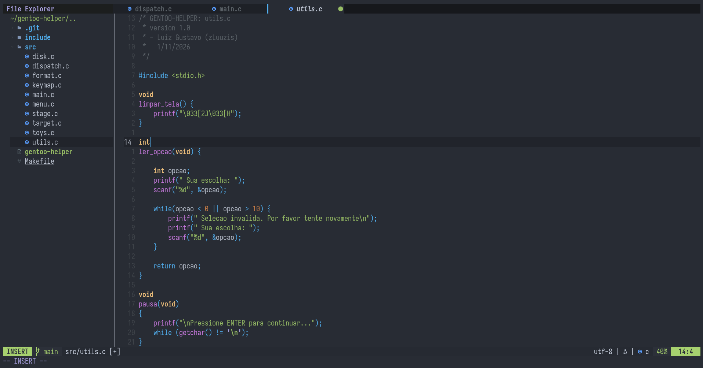
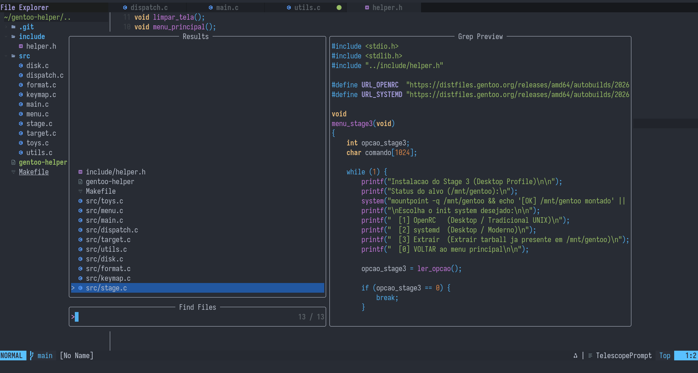

# ⚡ Configuração do Neovim

Configuração moderna, rápida e modular para **Neovim (>= 0.11)** focada no desenvolvimento em C, Lua e Shell, utilizando o LSP nativo, Treesitter, autocompletar inteligente e o tema Doom One.

---

## 📸 Capturas de Tela

<p align="center">
  
</p>

<p align="center">
  
</p>

---

## ✨ Recursos

- **Gerenciador de Plugins:** [lazy.nvim](https://github.com/folke/lazy.nvim) (carregamento assíncrono e sob demanda).
- **LSP Nativo (`vim.lsp`):** Integração com `clangd` e `lua_ls` gerenciados via [mason.nvim](https://github.com/williamboman/mason.nvim).
- **Diagnósticos em Tempo Real:** Avisos e mensagens de erro explícitas na linha via `virtual_text`.
- **Autocompletar e Snippets:** [nvim-cmp](https://github.com/hrsh7th/nvim-cmp) integrado com [LuaSnip](https://github.com/L3MON4D3/LuaSnip) e fechamento automático de delimitadores com [nvim-autopairs](https://github.com/windwp/nvim-autopairs).
- **Sintaxe e Destaque:** [nvim-treesitter](https://github.com/nvim-treesitter/nvim-treesitter).
- **Fuzzy Finder:** [telescope.nvim](https://github.com/nvim-telescope/telescope.nvim) para navegação rápida em arquivos e buffers.
- **Explorador de Arquivos:** [nvim-tree.lua](https://github.com/nvim-tree/nvim-tree.lua).
- **Interface e Linha de Estado:** Tema [doom-one.nvim](https://github.com/NTBBloodbath/doom-one.nvim), abas com [bufferline.nvim](https://github.com/akinsho/bufferline.nvim) e barra inferior via [lualine.nvim](https://github.com/nvim-lualine/lualine.nvim).

---

## 📦 Dependências do Sistema

Antes de iniciar, certifique-se de que as ferramentas essenciais de CLI e de compilação estejam instaladas no sistema hospedeiro:

### Arch Linux
```bash
sudo pacman -S neovim git base-devel unzip tar gzip curl ripgrep fd
```

### Fedora
```bash
sudo dnf install neovim git gcc gcc-c++ make unzip tar gzip curl ripgrep fd-find
```

### Debian / Ubuntu
> **Atenção:** Requer Neovim 0.11+. Caso o repositório da sua versão traga uma versão antiga, utilize a AppImage ou o tarball oficial.

```bash
sudo apt update && sudo apt install git build-essential unzip tar gzip curl ripgrep fd-find
```

> **Dica:** Configure uma [Nerd Font](https://www.nerdfonts.com/) (como *JetBrains Mono Nerd Font* ou *Iosevka Nerd Font*) no seu terminal para que todos os ícones da interface sejam renderizados corretamente.

---

## 🚀 Instalação e Uso

1. Clone o repositório diretamente no diretório de configuração padrão do Neovim:

```bash
git clone https://github.com/oluizf/nvim.git ~/.config/nvim
```

2. Inicie o Neovim:

```bash
nvim
```

> O `lazy.nvim` fará o bootstrap inicial automaticamente, clonando todos os plugins declarados. Em seguida, o `mason.nvim` cuidará do download dos Language Servers (`clangd`, `lua_ls`).

---

## ⌨️ Atalhos Principais

A tecla `<leader>` está mapeada para a **barra de espaço** (`<Space>`).

### Navegação Geral e Painéis

| Atalho | Modo | Descrição |
|---|---|---|
| `<leader>e` | Normal | Abre / fecha o explorador de arquivos (NvimTree) |
| `<leader>ff` | Normal | Pesquisa arquivos no projeto via Telescope |
| `<leader>fg` | Normal | Busca textual global nos arquivos (`live_grep`) |
| `<leader>fb` | Normal | Lista e alterna entre buffers abertos |
| `<leader>x` | Normal | Fecha o buffer atual |
| `H` | Normal | Vai para a aba anterior |
| `L` | Normal | Vai para a próxima aba |

### LSP e Diagnósticos

| Atalho | Modo | Descrição |
|---|---|---|
| `gd` | Normal | Pula para a definição da função / variável |
| `K` | Normal | Exibe janela flutuante com a documentação do símbolo |
| `<leader>rn` | Normal | Renomeia o símbolo em todo o projeto |
| `<leader>ca` | Normal | Abre menu de ações de código (*Code Actions*) |
| `<leader>d` | Normal | Abre popup flutuante com detalhes do erro na linha |
| `[d` | Normal | Salta para o diagnóstico anterior |
| `]d` | Normal | Salta para o próximo diagnóstico |
| `<leader>f` | Normal | Formata o código do buffer ativo |

### Autocompletar (Modo Inserção)

| Atalho | Ação |
|---|---|
| `<Tab>` ou `<C-n>` | Seleciona a próxima sugestão da lista |
| `<S-Tab>` ou `<C-p>` | Seleciona a sugestão anterior da lista |
| `<CR>` (Enter) | Confirma e insere a sugestão selecionada |
| `<C-e>` | Cancela e fecha o menu de sugestões |
| `<C-f>` / `<C-b>` | Rola para frente / trás o popup de documentação |
